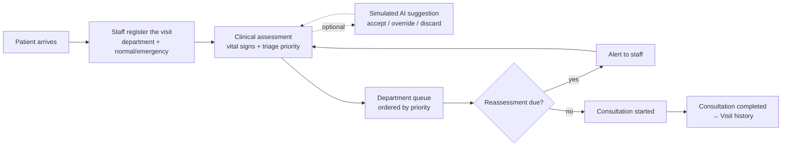

<div align="center">

# TRIORA — Smart Hospital Triage & Patient Management System

**A web-based workspace that helps hospital staff register patients, prioritise them by clinical urgency, manage department queues and catch overdue reassessments.**

### 🌐 [Live Demo → triora-wng7.onrender.com](https://triora-wng7.onrender.com)


</div>

> [!IMPORTANT]
> TRIORA is an **academic demonstration project**. It is **not** intended for real hospital use, and its AI feature is **simulated and not clinically validated**. Use **fictional patient data only**.

> [!NOTE]
> The live demo runs on a free hosting plan. If nobody has used it for about 15 minutes, the **first page load can take up to a minute** while the server wakes up.

---

## Table of contents

- [The problem](#the-problem)
- [Key features](#key-features)
- [User roles](#user-roles)
- [How it works](#how-it-works)
- [Technologies](#technologies)
- [Project structure](#project-structure)
- [Running TRIORA locally](#running-triora-locally)
- [Deployment](#deployment)
- [Notes and limitations](#notes-and-limitations)
- [Future work](#future-work)

---

## The problem

Hospitals can become overcrowded. Long waiting times make it hard to see which patients need urgent attention, and patients who are waiting may need to be checked again before their condition changes.

TRIORA gives staff one place to:

- register patient visits and send them to the right department,
- record a clinical assessment and a **triage priority** (Critical, High, Medium or Low),
- see **Normal** and **Emergency** queues ordered by priority and waiting time,
- get **alerts when a waiting patient is due for reassessment**, and
- see department workload at a glance.

Clinical staff always make the final decision. TRIORA supports their judgment and never replaces it.

---

## Key features

| Feature | What it does |
|---|---|
| **Patient registration** | Records a patient's details, department and visit type (normal or emergency), and gives each patient a unique ID such as `TR-001001`. |
| **Triage assessments** | Clinical staff record the chief complaint, symptoms, vital signs, notes and a triage priority. Out-of-range vital signs are rejected. Every assessment is kept in the patient's history. |
| **Normal & Emergency queues** | Live queues ordered by priority, then by manual order, then by arrival. Waiting times are shown and the queues refresh automatically. Staff can filter by department. |
| **Priority editing & reordering** | Clinical staff can change a waiting patient's priority and move patients up or down within the same priority group. Out-of-date screens can't overwrite someone else's change. |
| **Consultations & Visit history** | Staff start and complete consultations. Completed visits move to Visit history, which records the waiting time and the priority at consultation. |
| **Departments & workload** | Management can add, rename, deactivate and reactivate departments. Departments are never deleted, so history is kept. Shows how many patients are waiting and in consultation per department. |
| **Reassessment alerts** | Management configures a reassessment interval for each priority. Waiting patients become *due soon*, *due* and then *overdue*. Clinical staff can mark *Not required* or *Remind later*. Alerts never change a patient's priority automatically. |
| **Simulated AI triage demonstration** | Shows how an AI priority suggestion *could* be reviewed. Staff pick one of five fictional demo scenarios, then **accept, override (with a reason) or discard** the suggestion, and the decision is recorded. No real AI, external service or API key is used. |
| **Live dashboard** | Today's registrations, waiting patients, emergency cases, active departments, recent activity, department workload and reassessment alerts. It refreshes every minute. |
| **User management & audit log** | Administrators approve accounts, change roles and enable or disable accounts. Every change is recorded in an audit log. |
| **Security** | Role-based permissions checked on the server for every request, hashed passwords (bcrypt), secure HTTP-only session cookies, protection against repeated failed logins, and security headers. |

---

## User roles

Everyone signs in on the **same login page**. The role stored for the account decides what the user can see and do.

| Role | Can do | Cannot do |
|---|---|---|
| **Doctor / Nurse** (clinical staff) | Register patients; record assessments; view clinical details; change priorities and reorder queues; start and complete consultations; use the simulated AI demo; act on reassessment alerts | Manage departments, edit reassessment settings or manage users |
| **Hospital management** | View dashboard, patients, queues, Visit history and alerts; register patients; manage departments; edit reassessment settings | See clinical details (complaints, assessments, notes, AI suggestions, priorities outside the queues) or perform clinical actions |
| **System administrator** | Everything above, plus **User management** (approve accounts, change roles, enable or disable accounts) and the audit log | Change their own account, or disable the last active administrator |

**Registration:** staff can register themselves as Doctor, Nurse or Hospital management. **Administrator accounts can't be self-registered.** They are created only with a secure setup script or by an existing administrator.

---

## How it works



1. **Register:** staff record the patient and choose a department and visit type.
2. **Assess:** clinical staff record the assessment and choose a triage priority. They can optionally try the simulated AI suggestion first.
3. **Queue:** the patient appears in the Normal or Emergency queue, ordered by priority.
4. **Monitor:** waiting times and reassessment alerts show which patients need attention.
5. **Consult:** a doctor starts and completes the consultation, and the visit moves to Visit history.

> **Emergency rule:** possible emergencies must be handled under the hospital's emergency protocol and must never wait for any part of this workflow.

---

## Technologies

| Layer | Technology |
|---|---|
| Frontend | React 19, React Router 7, Vite 8, plain CSS |
| Backend | Node.js, Express 5 |
| Database | PostgreSQL hosted on [Neon](https://neon.com) (`pg` driver) |
| Authentication | `express-session` with sessions stored in PostgreSQL (`connect-pg-simple`), `bcryptjs` password hashing |
| Hosting | [Render](https://render.com) free web service (configured in `render.yaml`) |
| Code quality | ESLint |

No paid AI services or external AI APIs are used.

---

## Project structure

```text
├── client/                    React frontend (Vite)
│   ├── src/
│   │   ├── App.jsx            Routes and the public welcome page
│   │   ├── Dashboard.jsx      Live operations dashboard
│   │   ├── Patients.jsx       Patient registration and records
│   │   ├── PatientDetails.jsx Patient profile, visits, assessments, AI demo
│   │   ├── Queues.jsx         Normal and Emergency queues
│   │   ├── CompletedVisits.jsx  Visit history
│   │   ├── Departments.jsx    Departments and workload
│   │   ├── Reassessments.jsx  Reassessment alerts and settings
│   │   ├── Users.jsx          User management (administrators)
│   │   ├── Login.jsx / Register.jsx
│   │   └── theme.css          Shared design values
│   └── vite.config.js         Dev server (forwards /api to the backend)
├── server/                    Express backend
│   ├── server.js              App setup, security headers, sessions
│   ├── routes/                API endpoints (auth, patients, triage, queues, …)
│   ├── lib/                   Permissions, auth checks, reassessment logic,
│   │                          simulated AI provider, login limiter
│   ├── scripts/create-admin.js  Secure first-administrator setup
│   └── setup-db.js            Creates and updates the database tables
├── render.yaml                Render deployment settings (no secrets)
└── screen_plan.md             Original screen-by-screen design plan
```

---

## Running TRIORA locally

### Requirements

- [Node.js](https://nodejs.org) 22 or newer (developed with Node.js 24)
- A PostgreSQL database. A free [Neon](https://neon.com) project works well.

### 1. Install dependencies

```bash
cd server
npm install
cd ../client
npm install
```

### 2. Configure the backend

Create a file named `server/.env` with two values:

```env
DATABASE_URL=your-postgresql-connection-string
SESSION_SECRET=a-long-random-text
```

> `server/.env` is excluded from Git. **Never commit real connection strings or secrets.**

### 3. Create the database tables

```bash
cd server
node setup-db.js
```

This creates all tables and adds six starting departments (Emergency, General Medicine, Cardiology, Orthopedics, Neurology, Pediatrics). It is safe to run again. It doesn't delete existing data.

### 4. Create the first administrator

```bash
node scripts/create-admin.js
```

Run this in an interactive terminal. The password is typed into a hidden prompt and only a secure hash is stored.

### 5. Start the app (two terminals)

```bash
# Terminal 1 – backend (http://localhost:5000)
cd server
node server.js
```

```bash
# Terminal 2 – frontend (http://localhost:5173)
cd client
npm run dev
```

Open **http://localhost:5173**. During development, Vite forwards `/api` requests to the backend.

### Useful checks

```bash
cd client
npm run lint     # code quality
npm run build    # production build
```

---

## Deployment

The live demo is a single **Render** web service:

- Render builds the React frontend, and the Express backend serves both the website and the API from **one address**.
- The live site is set up with its **own Neon database branch**, separate from the development database.
- `DATABASE_URL` and `SESSION_SECRET` are stored privately in Render's settings, never in this repository.
- Pushing approved changes to the deployment branch redeploys the site automatically.

---

## Notes and limitations

- 🎓 **Academic demonstration only.** TRIORA is not a certified medical device and must not be used for real patient care.
- 🧪 **Fictional data only.** Never enter real patient information.
- 🤖 **The AI is simulated.** The "AI suggestion" comes from five fixed, fictional demonstration scenarios. It does not analyse the patient and is **not clinically validated**. Its output must never be used for real decisions.
- 🩺 **Clinical staff decide.** Priorities are always set by qualified staff. Reassessment intervals must be approved by qualified clinical staff before they are switched on.
- 💤 **Free hosting.** The live demo sleeps after about 15 minutes without visitors and takes up to a minute to wake up.
- 🔑 **Demo accounts.** Demo login details are not published here. Ask the project team, or register a staff account on the live site.
- 🏥 **Single hospital.** One installation serves one hospital. There is no "change password" page yet.

---

## Future work

These ideas come from the original project plan and are **not implemented yet**:

- Multiple hospitals, each with its own profile and specialties
- Specialty-specific assessment forms
- A real, properly trained and clinically validated priority model, replacing the simulation
- Alerts when waiting time exceeds a configured limit
- Self-service password change and reset

---

<div align="center">

**TRIORA** · Academic project · Designed to support care teams, not replace clinical judgment.

</div>
